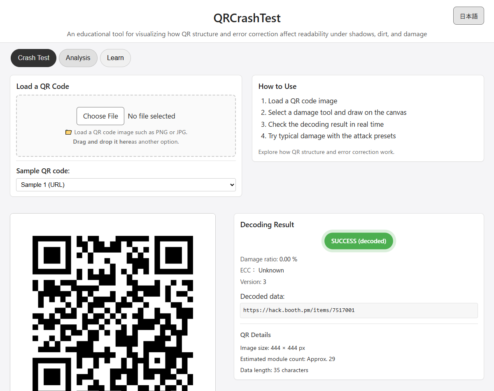
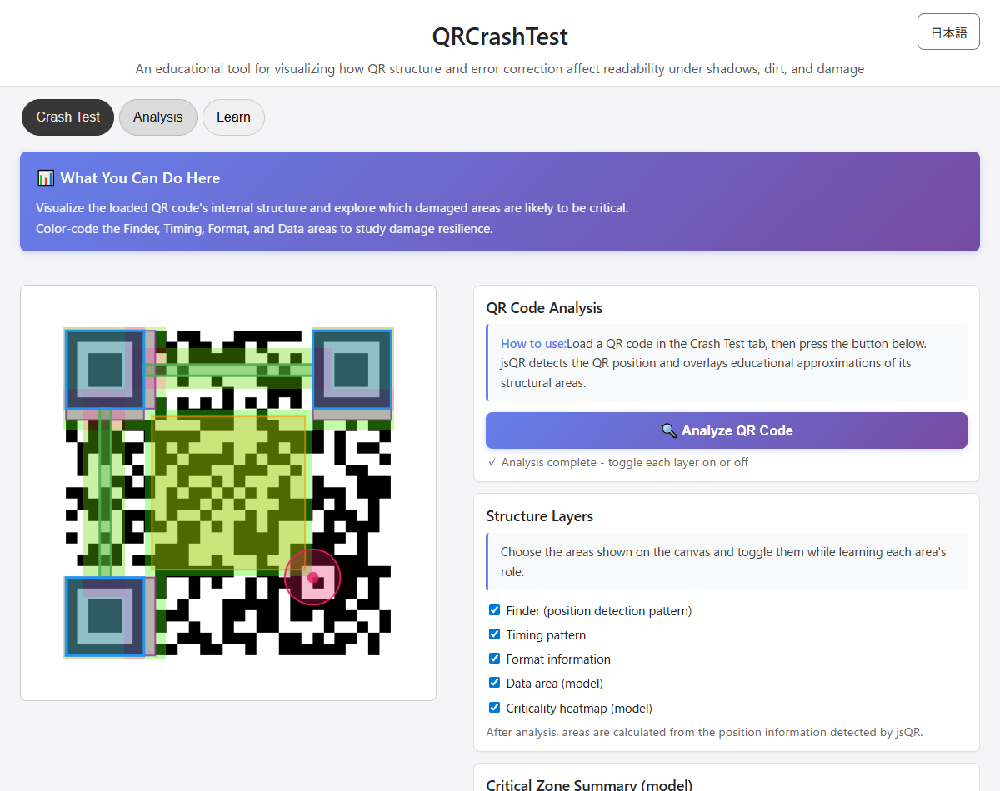

# QRCrashTest - QR Code Resilience Lab

[日本語](README.md) | English

[](https://ipusiron.github.io/qrcrashtest/)

**Day102 - Security Tools Built with Generative AI 200**

QRCrashTest is a browser-based educational lab for exploring how shadows, dirt, occlusion, blur, contrast, and rotation affect QR decoding. It visualizes QR structure and an educational criticality model while testing the displayed composite image with jsQR 1.4.0.

## Demo

Open [QRCrashTest on GitHub Pages](https://ipusiron.github.io/qrcrashtest/). No upload is required: images and keys remain in the browser.

## Screenshots





## Practical experiments

- Repeat the Finder Attack preset with seed `day102` to reproduce exactly the same damage for a class demonstration.
- Hold the damage and seed constant, then compare blur `2px`, contrast `80%`, and rotation `5deg` one variable at a time.
- Compare Finder Attack with Data Damage under the same seed to explore why damage location matters.
- Model shadows, stickers, poor contrast, or rotation as an educational approximation of capture and print problems.

## Features

- Load PNG/JPG QR images by file picker or drag and drop.
- Generate two built-in samples entirely in the browser.
- Draw with pen, dirt, shadow, sticker, and noise tools.
- Apply five categorized presets: Finder Attack, Timing Attack, Data Damage, Global Degradation, and Corner Sticker.
- Reproduce preset damage with a text seed and repeat the same conditions.
- Add blur, contrast, and rotation to the combined source and damage layers.
- Decode after each change and show the decoded data and damaged-pixel ratio.
- Visualize Finder, Timing, Format, Data, and an educational criticality heatmap.
- Switch the complete interface between Japanese and English without clearing the loaded image, damage, or active tab.
- Run from GitHub Pages, a local HTTP server, or directly through `file://` with no CDN dependency.

## How to use

1. Load a QR code or select a sample in the **Crash Test** tab.
2. Draw damage manually, or select a seed and apply a preset.
3. Optionally add blur, contrast, or rotation.
4. Check the result and the recorded experiment conditions.
5. Open **Analysis** and press **Analyze QR Code** to view the educational structure model.
6. Open **Learn** for QR structure, error-correction, alignment-pattern, and experiment guidance.

The **Repeat Same Conditions** button redraws the last preset using the current seed. The same seed and preset produce the same damage. Effects are post-processing conditions applied to the combined QR and damage image.

## What the result means

- `SUCCESS` or `FAIL` is one decoding attempt by jsQR 1.4.0 on the displayed composite image.
- The result does not guarantee the same behavior with a different camera, decoder, printer, distance, focus, lighting, or surface.
- The damage ratio is the share of nontransparent pixels in the damage layer. It is not the QR standard's correctable codeword percentage.
- The often-cited L/M/Q/H values of roughly 7/15/25/30 percent describe approximate codeword recovery, not a guaranteed damaged image area.
- jsQR does not expose the QR error-correction level here, so the UI reports it as **Unknown**.
- Structure overlays and criticality scores are educational approximations. They do not decode exact Format information, mask selection, codeword placement, or interleaving.

QRCrashTest is therefore an observation tool, not a QR quality certification tool and not evidence that a printed code is reliable in the field.

## Privacy and offline operation

All processing is client-side. The app does not upload selected images. Built-in samples are generated locally with qrcode-generator; their contents are not sent to a third-party QR API. jsQR and qrcode-generator are vendored in this repository, so the app can work offline from the first load.

## Tests

No package installation is required.

```bash
npm test
```

The test suite covers document/security invariants, seeded randomness and effect bounds, primary translations, QR versions 1 through 40, alignment positions, and rotated/non-square geometry.

## Project structure

```text
qrcrashtest/
├── index.html
├── style.css
├── script.js
├── i18n.js
├── qr-core.js
├── experiment-core.js
├── README.md
├── README.en.md
├── assets/
│   ├── screenshot1.png
│   ├── screenshot2.png
│   └── samples/
├── test/
│   ├── document.test.js
│   ├── experiment-core.test.js
│   ├── i18n.test.js
│   └── qr-core.test.js
└── vendor/
    ├── jsQR.js
    ├── qrcode.min.js
    ├── LICENSE-jsQR.txt
    └── LICENSE-qrcode-generator.txt
```

## Related tools

- [ImageDiffSec (Day021)](https://ipusiron.github.io/image-diff-sec/) compares two images and visualizes changes. It does not focus on QR structural resilience.
- [QR Risk Radar (Day074)](https://ipusiron.github.io/qr-risk-radar/) assesses risks in a decoded URL. It does not test physical QR damage.

## License

This project is released under the [MIT License](LICENSE). Vendored jsQR is distributed under Apache-2.0, and qrcode-generator under MIT; their license texts are included in `vendor/`.

This tool is part of the [Security Tools Built with Generative AI 200](https://akademeia.info/?page_id=44607) project.
